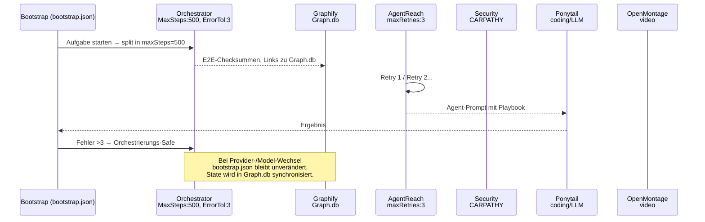

# AI-System-3.0 Core - System Blueprint v2

**Purpose**: Unbeugsames Ecosystem-Persistenz-Framework für lokale KI-Skills, Playbooks und State-Zonen.  
**LastModified**: 2026-11-04

---

## Root Principles

### 🧱 1. YAGNI + Immutable State
- **Ziel**: Kein flüchtiger Prompt-Kontext bei Provider-/Modell-Auswechseln.
- **Ausführung**: `bootstrap.json` wird beim Start als unverändertes System-Basis-Paket angelegt.  
- **Speicherdauer**: Alle veralteten States (Prompts, Templates) in einer `AI-System-Core.md`.

### 🕳️ 2. State-Persistenz mit Graphify
| Ordner | Inhalt | Purpose |
|--------|--------|---------|
| `Graph.db` | Alle Verbindungs-, API-, Edge-Zitate | Provider-Architektur, Links, E2E-Checks |
| `learnings/` | Fehler-Fixes (x³), Agent-Skills, Playbooks | Ständiges Lernen & Aggregierte Verbesserung |

### 🛡️ 3. Hard Gates für Fehlermanagement
- **MaxSteps** pro Aufgabe: `500`  
- **ErrorTolerance**: `3` – nach 3 Fehlern wird der Plan über **Rat** (OpenAI+Context7) geprüft und dann an **Orchestrator** gesendet.

---

## Root Architecture

1. **root/**
   - `bootstrap.json` → unveränderlicher State-Root für AI-System 3.0  
   - `AI-System-Core.md` → veraltete System-Datensatz, Logs, Fehler  
   - `Graph.db` (extern) → alle Links und Provider-Zitate

2. **orchestrator/**
   - `playbooks/` – Playbook für jede Aufgabe  
   - `state.lock` – immutable State-Synchronisierung  

3. **graphify/**
   - `Graph.db` – verknüpfte E2E-Checksummen, Links, API-Zitate

4. **obsidian-brain/**
   - `error_logs/` → x³ Fehler-Records
   - `learnings/` → Agent-Skill-Fixes, Playbooks

---

## Workflow Flow



---

## Root File Layouts

| Datei/Ordner | Inhalt | Purpose |
|--------------|--------|---------|
| `bootstrap.json` | unverändertes System-Basis-Paket<br>Active:true, State:Provider:ollama<br>Playbooks, Playbook-Paths | **Startpunkt für jedes Start**<br>**Zurück zur immutable Struktur** |

---

## Root Commands & Tools

### `git add -u` (immutable state)
```bash
cd E:\AI-System 3.0\node_modules\...
git add bootstrap.json AI-System-Core.md graph.db learnings/*
```
> **Speichert** unverändertes `State-Persistenz-Framework`.  
> **Ignoriert** flüchtige Logs/Fehler (in veralteten State-Zonen).

---

## Root File Contents

### `bootstrap.json`
| Feld | Wert |
|------|------|
| system.active | true |
| system.provider | "ollama" (default) |
| system.models | ["ollama", "openai", "chatbot"] |
| orchestrator.enabled | true |
| orchestration.schedule.interval | "30s" / "maxSteps:500" / "errorTolerance:3" |

### `AI-System-Core.md`
```markdown
# AI-System 3.0 - State-Persistenz-Framework

## Veraltete Dateien
```json
{...old state...}
```

## Fehler-Logs & State-Archivierung
```json
{...error logs of failed actions...}
```

## Playbooks (Playbook-Paths)
```json
{"path": "orchestrator/playbooks/task-a/playbook.json"}
```

---

## Root Execution Steps

1. **Starten** → Bootstrapper wird automatisch geladen.  
2. **Gruppieren** → All Task-Pieces in `orchestrator` → playbooks/States.  
3. **Partitionieren** → Aufgaben unter MaxSteps (500) geteilt.  
4. **Testen** → E2E-Tests: Graphify, AgentReach, Security.  
5. **Speichern** → State wird in `Graph.db` gesynchronisiert und `bootstrap.json` bleibt immutabel.
